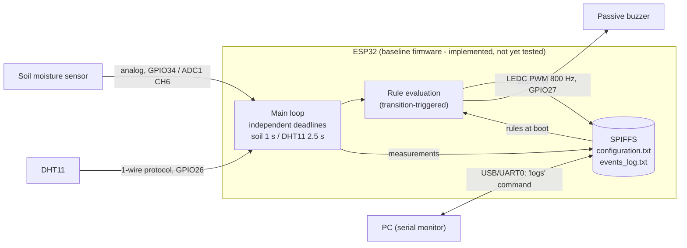
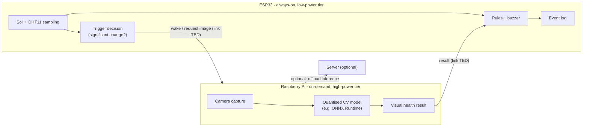

# System architecture

## 1. Current known architecture (implemented)

Only the ESP32 part exists as integrated code. The Raspberry Pi part is being
developed separately, and the link between the two boards is not defined.

## 2. Proposed architecture (not yet agreed or implemented)

The intent is a **hierarchical sensing** design: the ESP32, which consumes
much less power than the Raspberry Pi, runs continuously and decides when
the camera and computer vision are worth activating. Whether this saves
energy overall depends on the Raspberry Pi's idle and boot energy, which has
to be measured (Experiments 3 and 5) before the design is adopted.

## 3. Responsibilities

| Function | ESP32 | Raspberry Pi | Status |
| --- | --- | --- | --- |
| Soil / temperature / humidity acquisition | ✔ | | Implemented (baseline) |
| Rule evaluation and buzzer | ✔ | | Implemented (baseline) |
| Event log | ✔ (environmental) | ? (visual events) | ESP32 part implemented; final location TBD |
| Wall-clock time | ? | ? (could provide time to ESP32) | Not started |
| Camera capture | | ✔ | In development |
| Computer vision | | ✔ (or server) | In development |
| Camera activation policy | ? | ? | Proposed (Experiment 3) |
| Buzzer alert for visual distress | ✔ (buzzer is on ESP32) | sends result | Not started |

## 4. Communication - to be defined

No protocol has been chosen. Options to be compared:

| Option | Notes |
| --- | --- |
| UART (GPIO, 3.3 V) | A prototype exists from the labs (`pi_wake/`): ESP32 UART2 TX=GPIO17 / RX=GPIO16 at 115200 baud, line protocol `PING`→`READY`, message→`ACK`, plus an open-drain wake pulse on GPIO25. No Wi-Fi needed. **Not confirmed for the final system.** |
| Wi-Fi (MQTT / HTTP) | No extra wiring; Wi-Fi is a major energy cost on the ESP32 and restricts ADC2 (GPIO34 is ADC1, so not affected). |
| USB serial | Simple cabling; the ESP32 dev board's USB bridge stays powered. |

Selection criteria: energy per message, ability to wake the Raspberry Pi,
reliability, wiring complexity, and what can be demonstrated in the time
available.

## 5. Open points

- Raspberry Pi model, camera model and how the Raspberry Pi is powered and
  woken (the `pi_wake` lab suggests a GPIO wake pulse; to be confirmed).
- Whether the final `events_log.txt` is kept on the ESP32, the Raspberry Pi,
  or both.
- Time source for calendar timestamps.
